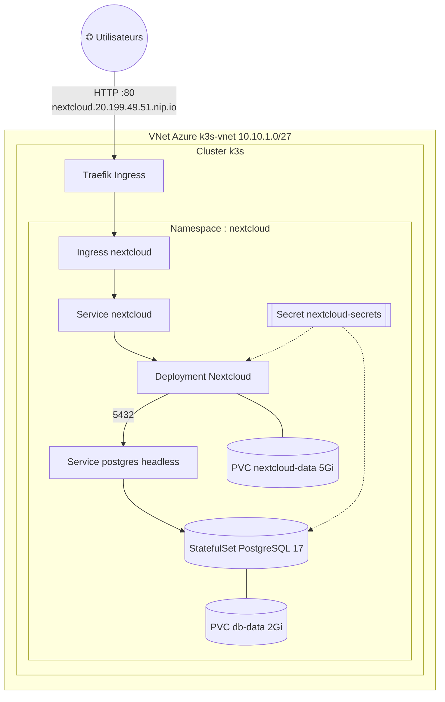
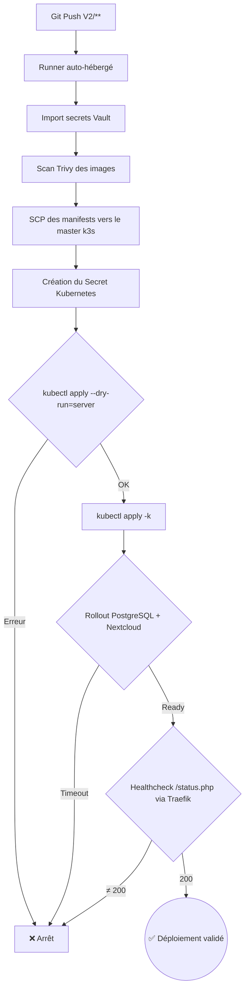

# Projet CSI - Déploiement Sécurisé Nextcloud

Ce dépôt contient l'infrastructure as code (IaC) et la configuration CI/CD pour le déploiement automatisé et sécurisé d'une instance Nextcloud adossée à une base de données PostgreSQL. Ce projet s'inscrit dans le cadre du jalon "Docker & CI/CD" du module CSI (Conteneurisation & Orchestration).

## Stack Technique & Architecture

* **Application :** [Nextcloud](https://nextcloud.com/) (image officielle Apache durcie).
* **Base de données :** PostgreSQL 15 (Alpine).
* **Conteneurisation :** Docker & Docker Compose (V2).
* **Hébergement :** VPS OVH (Ubuntu).
* **Exposition Publique :** Tunnel Cloudflare Zero Trust (réseau Docker externe `proxy-net`).
* **Gestion des Secrets :** HashiCorp Vault (centralisation de tous les mots de passe et clés SSH).
* **Sécurité & Scan :** Trivy (Aquasecurity).
* **CI/CD :** GitHub Actions (avec Runner auto-hébergé conteneurisé).

### Schéma d'Architecture Docker

Le schéma ci-dessous illustre l'isolation réseau mise en place : la base de données est inaccessible de l'extérieur, et seul le tunnel Cloudflare expose l'application.

```mermaid
graph TD
    User((🌐 Utilisateurs)) -->|Requêtes HTTPS| CF

    subgraph VPS OVH [Serveur VPS OVH]
        subgraph Docker Engine [Moteur Docker]
            
            subgraph ReseauProxy [Réseau : proxy-net]
                CF[Cloudflare Tunnel]
                Vault[(HashiCorp Vault)]
                Runner[GitHub Runner Local]
            end

            subgraph ReseauApp [Réseau : nextcloud-net]
                DB[(PostgreSQL 15)]
            end

            APP[Nextcloud App]
            
            %% Connexions réseaux
            CF -->|Expose le port 80| APP
            APP -->|Lit/Ecrit (Port 5432)| DB
            APP -.->|Récupération variables| Vault
            
            %% Volumes
            VolApp[(Volume: nextcloud_data)]
            VolDB[(Volume: db_data)]
            APP --- VolApp
            DB --- VolDB
        end
    end
    
    classDef network fill:#f9f9f9,stroke:#333,stroke-width:2px;
    classDef container fill:#e1f5fe,stroke:#01579b,stroke-width:2px;
    classDef db fill:#e8f5e9,stroke:#2e7d32,stroke-width:2px;
    
    class CF,APP,Vault,Runner container;
    class DB,VolApp,VolDB db;
    class ReseauProxy,ReseauApp network;
```

##  Sécurité & Bonnes Pratiques Implémentées

Le projet respecte les standards de sécurité de l'industrie :

1. **Principe de moindre privilège :**
   * L'image Nextcloud tourne avec l'utilisateur non-root `www-data` (via un `Dockerfile` personnalisé).
   * Le déploiement CI/CD utilise un utilisateur système dédié (`cddeploy`) restreint via SSH.

2. **Gestion des Secrets (Zéro secret dans Git) :**
   * Aucun mot de passe n'est versionné.
   * Le pipeline interroge dynamiquement un serveur **HashiCorp Vault** pour récupérer les mots de passe (DB, Admin) et la clé SSH de déploiement en mémoire.
   * Le fichier `.env` est généré à la volée sur le VPS lors du déploiement et est exclu par `.gitignore`.

3. **Isolation Réseau :**
   * La base de données PostgreSQL est isolée sur un réseau interne (`nextcloud-net`) et n'est pas exposée à Cloudflare ni à l'hôte.

4. **DevSecOps :**
   * Analyse de vulnérabilités bloquante à chaque build via Trivy (échec du pipeline si failles `CRITICAL` ou `HIGH`).

##  Pipeline CI/CD Automatisé

L'intégration et le déploiement continus sont gérés par GitHub Actions (`.github/workflows/ci.yml`) et s'exécutent sur un runner Docker auto-hébergé sur le VPS.

### Fonctionnement de la chaîne d'intégration

Le workflow agit comme une suite de verrous (*gates*). Si une étape échoue (comme le scan Trivy ou le Healthcheck), le déploiement est immédiatement annulé.

```mermaid
graph TD
    A[Git Push] -->|Déclenche| B{GitHub Actions}
    B --> C[Runner Auto-hébergé sur VPS]
    
    subgraph Phase CI [CI : Intégration Continue & Sécurité]
        C --> D[Checkout du code source]
        D --> E[Connexion Vault & Import des Secrets]
        E --> F[Docker Build de l'image locale]
        F --> G{Scan Trivy}
    end
    
    G -->|Vulnérabilités CRITICAL/HIGH| Z[❌ Arrêt du Pipeline]
    G -->|Pass (Aucune faille majeure)| H[Connexion SSH au VPS]
    
    subgraph Phase CD [CD : Déploiement Continu]
        H -->|Utilisateur: cddeploy| I[Mise à jour via Git Pull]
        I --> J[Génération du .env sécurisé]
        J --> K[Docker Compose Down & Up -d]
        K --> L{Healthcheck des conteneurs}
    end
    
    L -->|Conteneur 'exited'| Z
    L -->|Tous les conteneurs 'Up'| M((✅ Déploiement Validé))
```

##  Guide de Déploiement Local (Développement)

Pour tester la stack en local sans la CI/CD :

1. **Cloner le dépôt :**
   ```bash
   git clone https://github.com/ynov-m2-table3/M2-Orchestration-Table3.git
   cd M2-Orchestration-Table3/V1
   ```

2. **Configurer l'environnement :**
   Copiez le fichier d'exemple et remplissez vos informations :
   ```bash
   cp .env.example .env
   ```

3. **Créer le réseau externe (requis pour le tunnel Cloudflare ou le Vault) :**
   ```bash
   docker network create proxy-net
   ```

4. **Lancer la stack :**
   ```bash
   docker compose up --build -d
   ```

---

# V2 - Déploiement Nextcloud sur cluster k3s (Azure)

La V2 déploie la même application (Nextcloud + PostgreSQL) sur un cluster **k3s** de 3 VMs Azure, avec un pipeline GitHub Actions dédié (`.github/workflows/cd-k3s.yml`).

## Infrastructure

| VM | Rôle | IP privée | IP publique |
|---|---|---|---|
| VM-k3s-1 | Master (control-plane) | 10.10.1.4 | 20.199.49.51 |
| VM-k3s-2 | Worker | 10.10.1.5 | 20.39.232.35 |
| VM-k3s-3 | Worker | 10.10.1.6 | 40.66.41.151 |

* **Réseau :** VNet Azure dédié `k3s-vnet` (`10.10.1.0/27`) : les nœuds communiquent uniquement par IP privée (API 6443, Flannel VXLAN 8472/udp, kubelet 10250).
* **OS :** Debian 13, k3s v1.37.



## Manifests (`V2/k8s/`)

| Fichier | Contenu |
|---|---|
| `00-namespace.yaml` | Namespace `nextcloud` (isolation des ressources) |
| `10-postgres.yaml` | StatefulSet PostgreSQL + Service headless interne + volume persistant |
| `20-nextcloud.yaml` | Deployment Nextcloud (stratégie `Recreate`, sondes `/status.php`) + PVC + Service |
| `30-ingress.yaml` | Ingress Traefik sur `nextcloud.20.199.49.51.nip.io` |
| `kustomization.yaml` | Point d'entrée : `kubectl apply -k V2/k8s` |

Le Secret `nextcloud-secrets` n'est **jamais versionné** : il est généré par le pipeline à partir de Vault.

## Pipeline CD k3s

Déclenché par un push sur `Mathis-Nextcloud` touchant `V2/**` (ou manuellement via *Run workflow*). La V1 (`ci.yml`) ignore ces chemins.



### Prérequis

1. **Vault** (`secret/SecretTP`) - en plus des clés V1 :

   | Clé | Valeur |
   |---|---|
   | `K3S_HOST` | `20.199.49.51` |
   | `K3S_USER` | `azureuser` |
   | `K3S_SSH_KEY` | Clé privée SSH des VMs (contenu complet du `.pem`) |

2. **NSG Azure** de `VM-k3s-1` : autoriser le port **80/TCP** entrant pour accéder à Nextcloud.

### Vérification manuelle

```bash
ssh azureuser@20.199.49.51
kubectl -n nextcloud get pods,svc,ingress,pvc -o wide
```